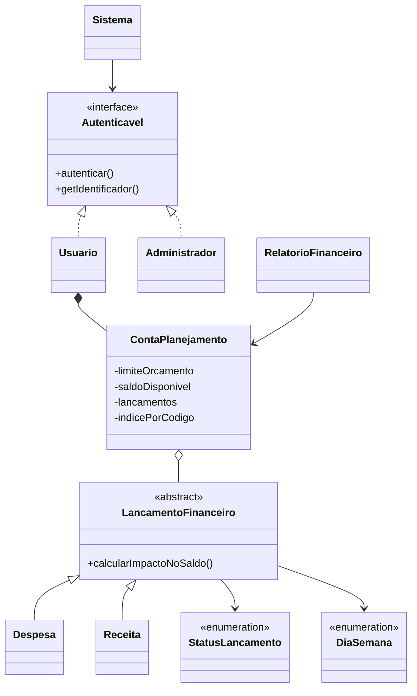

# 💰 Sistema de Planejamento Financeiro Pessoal — Projeto Integrador de POO (Java)

> Repositório pessoal com a **minha parte** no Projeto Integrador de Programação Orientada a Objetos do curso de Análise e Desenvolvimento de Sistemas (ADS). O projeto completo é desenvolvido em grupo por três integrantes; ao final, as três partes são reunidas em um único código.

📘 **Documentação completa, com exemplos e roteiro de apresentação:** [DOCUMENTACAO PROJETO POO](DOCUMENTACAO%20PROJETO%20POO.md)
---

## 📌 Sobre o projeto

O **Sistema de Planejamento Financeiro Pessoal** permite que um usuário controle receitas e despesas em uma conta com **limite de orçamento**, acompanhe o **status** de cada lançamento (pendente, confirmado ou cancelado) e consulte **relatórios** sobre seus gastos.

O projeto foi modelado a partir de um **Diagrama de Classes UML (UML 2.5)** e aplica os principais conceitos de POO em Java: abstração, herança, polimorfismo, encapsulamento, interfaces, composição, agregação, enums e coleções (`ArrayList` e `HashMap`).

## 🛠️ Tecnologias

- **Java** (desenvolvido para a versão mais recente; compatível com Java 21 ou superior)
- Programação Orientada a Objetos
- Modelagem em UML

---

## 🧩 Arquitetura geral

O sistema é composto por 8 classes de domínio, 1 interface e 2 enums.

| Elemento | Tipo | Responsabilidade |
|---|---|---|
| `Sistema` | Classe | Ponto de entrada: login, cadastro de usuários, menus e geração de relatórios |
| `Autenticavel` | Interface | Contrato de autenticação (`autenticar()`, `getIdentificador()`) |
| `Usuario` | Classe | Usuário comum; implementa `Autenticavel` e possui uma conta |
| `Administrador` | Classe | Usuário administrativo; implementa `Autenticavel` e audita contas |
| `ContaPlanejamento` | Classe | Conta financeira: limite de orçamento, saldo e coleção de lançamentos |
| `LancamentoFinanceiro` | Classe abstrata | Dados e comportamento comuns a todo lançamento |
| `Despesa` | Classe | Lançamento de saída, com categoria e taxa adicional |
| `Receita` | Classe | Lançamento de entrada, com origem e indicador de recorrência |
| `RelatorioFinanceiro` | Classe | Relatórios de leitura sobre a conta |
| `StatusLancamento` | Enum | `PENDENTE`, `CONFIRMADO`, `CANCELADO` |
| `DiaSemana` | Enum | Os sete dias da semana do lançamento |

### Diagrama de classes (resumo)



### Conceitos de POO aplicados

| Conceito | Onde aparece |
|---|---|
| Classe abstrata e herança | `LancamentoFinanceiro` ← `Despesa` e `Receita` |
| Polimorfismo | A conta guarda `Despesa` e `Receita` na mesma lista e chama `calcularImpactoNoSaldo()` de forma polimórfica |
| Coleções | `ArrayList` para os lançamentos e `HashMap` para consulta rápida por código |
| Interface | `Autenticavel`, implementada por `Usuario` e `Administrador` |
| Composição | `Usuario` ◆ `ContaPlanejamento` (a conta pertence ao ciclo de vida do usuário) |
| Agregação | `ContaPlanejamento` ◇ `LancamentoFinanceiro` |
| Enums | `StatusLancamento` e `DiaSemana` |
| Encapsulamento | Atributos privados/protegidos e regras de negócio protegidas dentro das classes |

---

## 👥 Divisão do trabalho

O projeto é dividido em três partes, uma por integrante. Cada um mantém um repositório pessoal com uma branch própria, e um único integrante faz a junção final e o deploy do código completo.

| Integrante | Responsabilidade |
|---|---|
| **Artur Henrique** (este repositório) | `StatusLancamento`, `ContaPlanejamento`, `RelatorioFinanceiro` |
| Integrante 2 | _(preencher)_ |
| Integrante 3 | _(preencher)_ |

---

## 🙋 Minha participação

Fiquei responsável pelo **núcleo financeiro** do sistema: onde os lançamentos ficam guardados, onde as regras de orçamento são aplicadas e de onde saem os relatórios.

### `StatusLancamento` — ciclo de vida do lançamento
Enum com os três estados possíveis de um lançamento:

- `PENDENTE`: registrado, ainda não efetivado (não afeta o saldo atual)
- `CONFIRMADO`: efetivado (afeta o saldo atual)
- `CANCELADO`: encerrado, não pode mais ser confirmado nem alterado

**Propósito:** padronizar os estados e evitar valores soltos (como textos) controlando o ciclo de vida do lançamento.

### `ContaPlanejamento` — conta e regras de orçamento
Representa a conta financeira do usuário. Guarda o limite de orçamento, o saldo inicial e os lançamentos.

- **`ArrayList<LancamentoFinanceiro>`** mantém a ordem de registro e permite percorrer `Despesa` e `Receita` de forma polimórfica.
- **`HashMap<Integer, LancamentoFinanceiro>`** serve de índice por código para buscar, atualizar e cancelar em tempo constante.
- Métodos: `registrarLancamento`, `buscarPorCodigo`, `atualizarLancamento`, `cancelarLancamento`, `excluirLancamento`, `listarLancamentos`, `calcularTotalDespesas` e `calcularSaldoAtual`.

**Propósito:** ser o único ponto de entrada para mexer nos lançamentos, garantindo que nenhuma regra de negócio seja burlada.

### `RelatorioFinanceiro` — relatórios
Classe somente de leitura: consulta a conta, mas não altera nada.

- `exibirResumoPorStatus()`: quantidade e valor de lançamentos em cada status
- `exibirGastosPorDiaSemana()`: despesas ativas agrupadas por dia da semana
- `exibirBalancoGeral()`: saldo inicial e atual, receitas, despesas e percentual de uso do limite

**Propósito:** dar ao usuário uma visão clara de para onde o dinheiro está indo e quanto do orçamento ainda resta.

### Regras de negócio implementadas

| Regra | Classe | Comportamento |
|---|---|---|
| **RN01** | `ContaPlanejamento` | Uma nova `Despesa` é bloqueada se a soma das despesas ativas (pendentes e confirmadas, com taxa) ultrapassar o limite de orçamento. A mesma verificação vale ao atualizar o valor de uma despesa. |
| **RN02** | `ContaPlanejamento` / `LancamentoFinanceiro` | Lançamento `CANCELADO` não pode ser alterado (aqui) nem confirmado (na superclasse). |
| **RN03** | `ContaPlanejamento` | Lançamento `CONFIRMADO` não pode ser excluído sem antes ser cancelado, preservando o histórico. |
| **RN04** | `ContaPlanejamento` / `Usuario` | Valor do lançamento deve ser maior que zero (aqui); e-mail de usuário não pode se repetir (no cadastro de usuários). |

Também é rejeitado o registro de dois lançamentos com o mesmo código.

> **Convenção:** `calcularImpactoNoSaldo()` retorna valor **com sinal**, negativo para `Despesa` (já somando a taxa adicional) e positivo para `Receita`. Os cálculos da conta e dos relatórios partem dessa convenção.

### Integração com as partes dos outros integrantes
As minhas classes dependem destes membros de `LancamentoFinanceiro`: `getCodigo()`, `getValor()`, `getStatus()`, `getDiaSemana()`, `setValor()`, `setNome()`, `setDescricao()`, `confirmar()` e `cancelar()`. O enum `DiaSemana` precisa ter `getDescricao()`.

---

## 📁 Estrutura de pastas

```
.
├── README.md
└── src
    └── planejamento
        ├── StatusLancamento.java
        ├── ContaPlanejamento.java
        └── RelatorioFinanceiro.java
```

Todas as classes do projeto usam o pacote `planejamento`.

## ▶️ Como compilar e executar

Depois de reunir as classes de todos os integrantes em `src/planejamento/`:

```bash
# compilar
javac -encoding UTF-8 -d out src/planejamento/*.java

# executar (a classe com o método main, definida pelo grupo)
java -cp out planejamento.Main
```

> Este repositório contém apenas a minha parte; sozinho ele não compila, pois depende das classes dos outros integrantes.

## ✅ Status

- [x] `StatusLancamento`
- [x] `ContaPlanejamento`
- [x] `RelatorioFinanceiro`
- [x] Regras de negócio RN01, RN02 (alteração), RN03 e RN04 (valor)
- [x] Testado com versões provisórias das demais classes
- [ ] Integração final com as classes dos outros integrantes

## 👤 Autor

**Artur Henrique** — estudante de Análise e Desenvolvimento de Sistemas (ADS), Unifip.
GitHub: [@arturhenrique-dev](https://github.com/arturhenrique-dev)
